# VeloVault 🚗 — Premium Car Dealership Inventory System

[](https://velo-vault-azure.vercel.app/login)
[](https://velovault.onrender.com)
[](https://cloud.mongodb.com)


A full-stack **Car Dealership Inventory Management System** built with **Node.js/Express**, **MongoDB Atlas**, and **React/Tailwind CSS**. Developed using **Test-Driven Development (TDD)** practices with comprehensive test coverage.

> ### 🚀 Live Application
> - 🖥️ **Live Web Application (Vercel):** [https://velo-vault-azure.vercel.app/login](https://velo-vault-azure.vercel.app/login)
> - ⚡ **Backend API Server (Render):** [https://velovault.onrender.com](https://velovault.onrender.com)
> - 🍃 **Cloud Database:** MongoDB Atlas Cluster
>
> **Demo Access Credentials:**
> - **Customer:** `customer@velovault.com` / `password123`
> - **Admin:** `admin@velovault.com` / `admin123` (access via `/admin-login`)

## 📋 Table of Contents

- [Live Application & Screenshots](#-application-screenshots)
- [Features](#features)
- [Tech Stack](#tech-stack)
- [Project Structure](#project-structure)
- [Setup & Installation](#setup--installation)
- [Running the Application](#running-the-application)
- [API Documentation](#api-documentation)
- [Testing](#testing)
- [My AI Usage](#my-ai-usage)

---

## 📸 Application Screenshots

### 1. Customer Login Portal
A clean, streamlined authentication gateway designed for dealership customers. Features secure email and password validation, one-click portal switching to the staff area, and persistent session management.

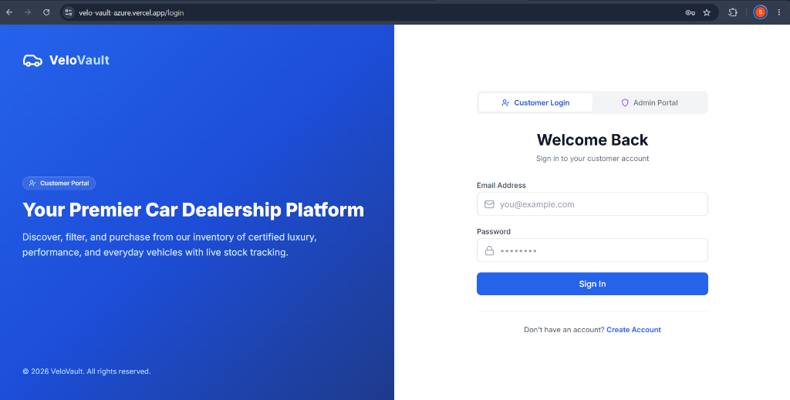

---

### 2. Dealership Admin Staff Portal
Dedicated, dark-themed administrative authentication environment built specifically for dealership managers, fleet supervisors, and inventory controllers with strict role-based access enforcement.

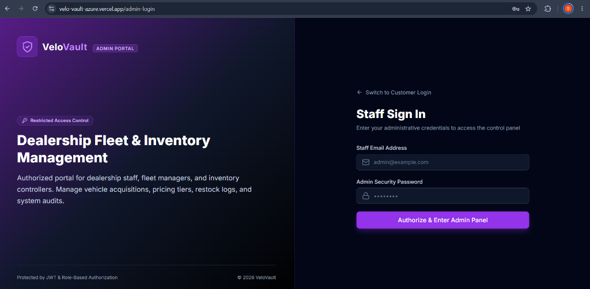

---

### 3. Vehicle Inventory Dashboard & Fleet Catalog
The core customer experience showcase featuring live fleet inventory cards, real-time stock availability, category tags (Coupe, Sedan, SUV, Truck, Hatchback, Convertible, Wagon), interactive search and multi-attribute filters, and instant purchase triggers with out-of-stock disabling.

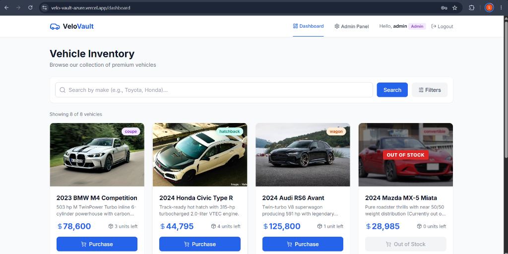

---

### 4. Admin Fleet Management Panel
Full-featured control center for inventory administrators. Displays tabular fleet metrics, stock levels with alert color-coding (in-stock, low-stock, out-of-stock), inline quick-restocking, edit triggers, and vehicle deletion safeguards.

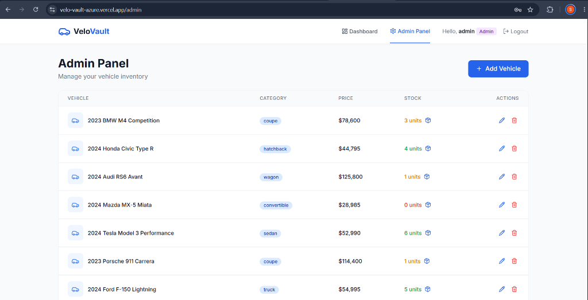

---

### 5. Vehicle Creation & Specification Modal
Interactive modal interface allowing dealership managers to add new acquisitions or modify existing vehicle data including make, model, model year, vehicle category, price in USD, stock volume, and image assets.

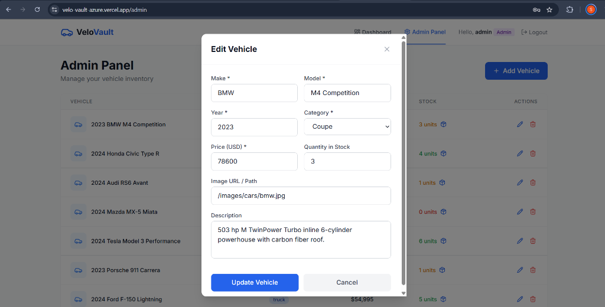

---

### 6. Live Vehicle Update & Restock Confirmation
Real-time user feedback showing instant inventory recalculation and interactive toast alerts (`Vehicle updated successfully`) upon adjusting vehicle pricing, stock quotas, or specifications.

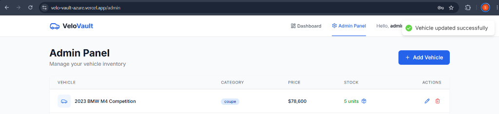

---

### 7. New Vehicle Acquisition Form
Detailed administrative modal allowing managers to register newly acquired vehicles with make, model, model year, body category dropdown, USD pricing, stock count, custom image path, and description.

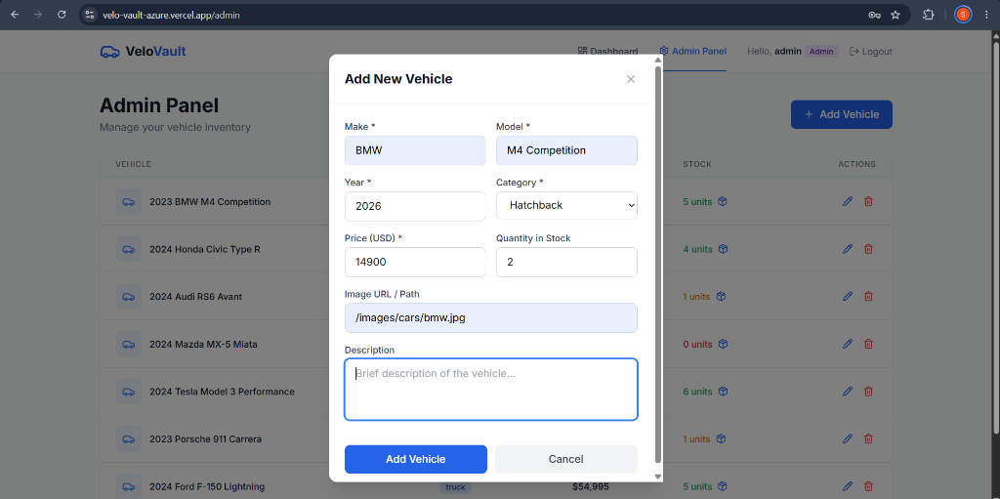

---

### 8. Live Vehicle Creation Notification
Visual confirmation showing instantaneous database synchronization (`Vehicle added successfully`) and automatic table re-render when a new car is introduced to the fleet.

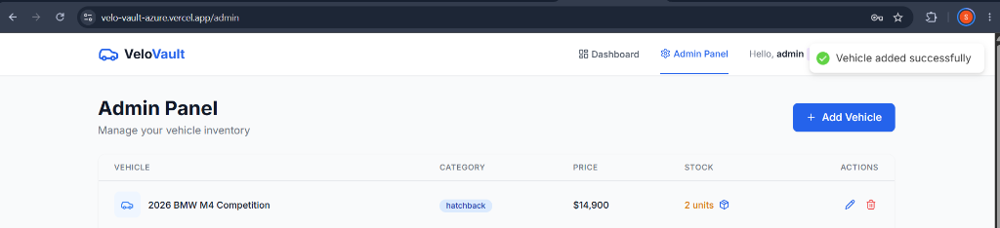

---

### 9. Secure Vehicle Deletion & Inventory Pruning
Administrative confirmation toast (`Vehicle deleted successfully`) verifying removal of sold-out or archived vehicle entries from the database.

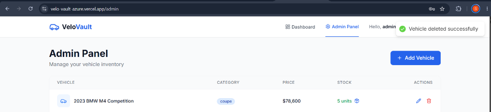

---

### 10. Advanced Multi-Criteria Search & Filter Engine
Comprehensive customer search tools in action, demonstrating real-time queries filtered by vehicle model (`M4 Competition`), custom price intervals (`$0` to `$100,000`), and category criteria with instant result counts.

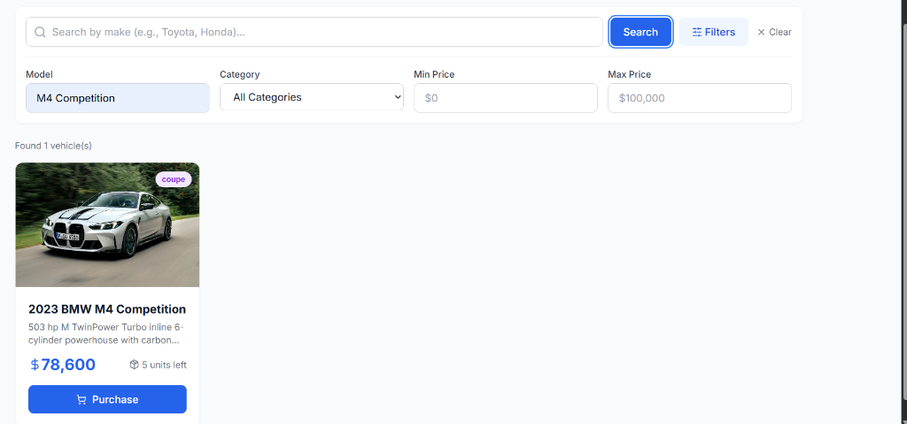

---

### 11. Customer Registration Portal
Interactive sign-up interface allowing new buyers to create an authenticated customer account with validation rules for username, email format, and password confirmation.

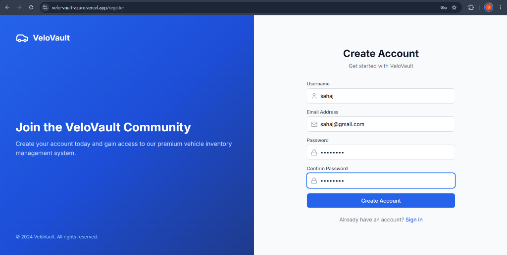

---

### 12. Vehicle Inventory Pre-Purchase (5 Units in Stock)
Customer logged in as `sahaj` viewing the live vehicle catalog. The **2023 BMW M4 Competition** shows **5 units left** in stock prior to purchase.

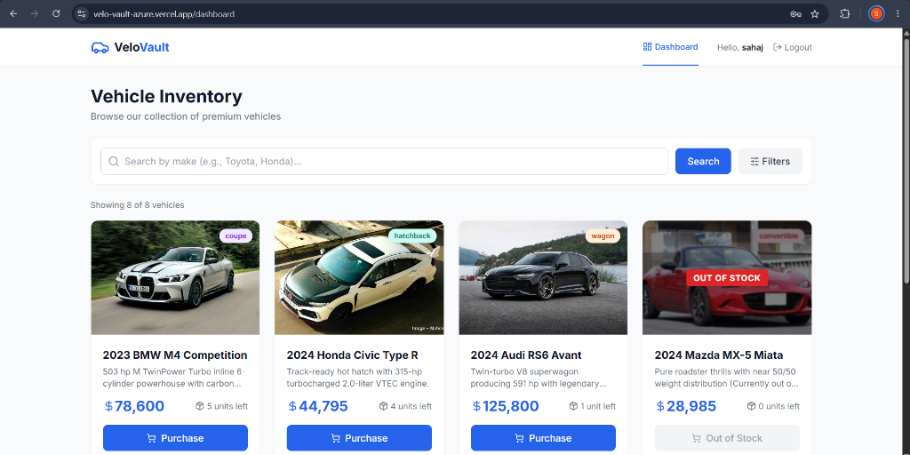

---

### 13. Instant Vehicle Purchase & Live Stock Decrement (4 Units Remaining)
Demonstrating the live purchasing workflow: clicking the **"Purchase"** button executes an authenticated `POST /api/vehicles/:id/purchase` request, displays a real-time toast notification (`Vehicle purchased successfully!`), and immediately decrements the BMW M4 Competition stock from **5 units down to 4 units left**.


---

## ✨ Features

### User Management
- **User Registration** with username, email, and password
- **JWT-based Authentication** for secure API access
- **Role-based Authorization** (User / Admin roles)

### Vehicle Inventory
- **CRUD Operations** — Add, view, edit, and delete vehicles
- **Search & Filter** — Search by make, model, category, and price range
- **Purchase System** — Buy vehicles with automatic stock management
- **Restock System** — Admin-only restocking capability
- **Pagination** — Efficient browsing of large inventories

### Frontend
- **Modern SPA** built with React 18 and React Router
- **Beautiful UI** with Tailwind CSS and Lucide icons
- **Responsive Design** — Works on all screen sizes
- **Real-time Feedback** — Toast notifications for all actions
- **Admin Dashboard** — Full inventory management interface

---

## 🛠 Tech Stack

| Layer      | Technology                              |
|------------|----------------------------------------|
| **Backend**    | Node.js, Express.js                |
| **Database**   | MongoDB with Mongoose ODM          |
| **Auth**       | JWT (JSON Web Tokens), bcryptjs    |
| **Frontend**   | React 18, React Router, Tailwind CSS |
| **Testing**    | Jest, Supertest, Vitest, React Testing Library |
| **Tooling**    | Vite, Nodemon, ESLint              |

---

## 📁 Project Structure

```
VeloVault/
├── backend/
│   ├── src/
│   │   ├── config/          # Database configuration
│   │   ├── controllers/     # Route handlers
│   │   ├── middleware/       # Auth & validation middleware
│   │   ├── models/          # Mongoose schemas
│   │   ├── routes/          # API route definitions
│   │   ├── services/        # Business logic layer
│   │   ├── utils/           # Helper utilities
│   │   ├── app.js           # Express app setup
│   │   └── server.js        # Server entry point
│   ├── tests/
│   │   ├── unit/            # Unit tests
│   │   ├── integration/     # API integration tests
│   │   └── setup.js         # Test environment setup
│   ├── package.json
│   └── jest.config.js
├── frontend/
│   ├── src/
│   │   ├── components/      # Reusable UI components
│   │   ├── pages/           # Page-level components
│   │   ├── services/        # API client
│   │   ├── context/         # React Context providers
│   │   └── test/            # Test setup
│   ├── package.json
│   └── vite.config.js
├── README.md
├── PROMPTS.md
└── .gitignore
```

---

## 🚀 Setup & Installation

### Prerequisites

- **Node.js** v18 or higher
- **MongoDB** v6 or higher (running locally or a cloud instance like MongoDB Atlas)
- **npm** or **yarn** package manager
- **Git**

### 1. Clone the Repository

```bash
git clone https://github.com/SahajNevatia/VeloVault.git
cd VeloVault
```

### 2. Backend Setup

```bash
cd backend
npm install
```

Create a `.env` file from the example:

```bash
cp .env.example .env
```

Update the `.env` file with your MongoDB connection string:

```env
PORT=5000
MONGODB_URI=mongodb://localhost:27017/velovault
JWT_SECRET=your_secure_secret_key_here
JWT_EXPIRES_IN=24h
NODE_ENV=development
```

### 3. Frontend Setup

```bash
cd frontend
npm install
```

### 4. Start MongoDB

Make sure MongoDB is running on your machine:

```bash
# If using local MongoDB
mongod

# Or if using MongoDB Atlas, just ensure your connection string is correct in .env
```

---

## ▶️ Running the Application

### Start Backend Server

```bash
cd backend
npm run dev
```

The API server will start on `http://localhost:5000`.

### Start Frontend Development Server

```bash
cd frontend
npm run dev
```

The frontend will start on `http://localhost:3000` and proxy API requests to the backend.

### Running Both Together

Open two terminal windows:
- **Terminal 1**: `cd backend && npm run dev`
- **Terminal 2**: `cd frontend && npm run dev`

---

## 📡 API Documentation

### Authentication Endpoints

| Method | Endpoint              | Description           | Auth Required |
|--------|----------------------|----------------------|---------------|
| POST   | `/api/auth/register` | Register new user     | No            |
| POST   | `/api/auth/login`    | Login & get JWT token | No            |

### Vehicle Endpoints

| Method | Endpoint                      | Description           | Auth Required | Admin Only |
|--------|------------------------------|-----------------------|---------------|------------|
| GET    | `/api/vehicles`              | List all vehicles     | Yes           | No         |
| GET    | `/api/vehicles/search`       | Search with filters   | Yes           | No         |
| GET    | `/api/vehicles/:id`          | Get single vehicle    | Yes           | No         |
| POST   | `/api/vehicles`              | Add new vehicle       | Yes           | No         |
| PUT    | `/api/vehicles/:id`          | Update vehicle        | Yes           | No         |
| DELETE | `/api/vehicles/:id`          | Delete vehicle        | Yes           | Yes        |
| POST   | `/api/vehicles/:id/purchase` | Purchase vehicle      | Yes           | No         |
| POST   | `/api/vehicles/:id/restock`  | Restock vehicle       | Yes           | Yes        |

### Example Requests

**Register:**
```bash
curl -X POST http://localhost:5000/api/auth/register \
  -H "Content-Type: application/json" \
  -d '{"username": "johndoe", "email": "john@example.com", "password": "secret123"}'
```

**Search Vehicles:**
```bash
curl http://localhost:5000/api/vehicles/search?make=Toyota&category=suv \
  -H "Authorization: Bearer YOUR_JWT_TOKEN"
```

---

## 🧪 Testing

### Backend Tests

```bash
cd backend

# Run all tests with coverage
npm test

# Run only unit tests
npm run test:unit

# Run only integration tests
npm run test:integration

# Watch mode for development
npm run test:watch
```

### Frontend Tests

```bash
cd frontend
npm test
```

### Test Coverage

The project follows **Test-Driven Development (TDD)** practices. Tests cover:

- **Model Validation**: User and Vehicle schema validation, constraints, and defaults
- **Service Layer**: Business logic for auth, CRUD, purchase, and restock operations
- **API Integration**: Full endpoint testing with authentication and authorization
- **Edge Cases**: Invalid data, duplicate entries, insufficient stock, unauthorized access

---

## 🤖 My AI Usage

### Tools Used

- **Google Gemini (Antigravity)**: Primary AI assistant used throughout the development process.

### How I Used AI

1. **Project Architecture & Planning**: I discussed the project requirements with Gemini to brainstorm the overall architecture, folder structure, and technology choices. It helped me decide on separating concerns with a service layer pattern.

2. **Model Schema Design**: I used Gemini to help design the Mongoose schemas with appropriate validations, ensuring fields like email regex patterns and category enums were production-ready.

3. **TDD Test Writing**: For each feature, I first described the expected behavior to the AI and asked it to help generate test cases. I then reviewed and modified the tests before writing the implementation. This ensured comprehensive coverage.

4. **Boilerplate Generation**: The AI helped generate initial boilerplate for Express middleware (auth, validation), controller structure, and API route setup, which I then customized.

5. **Frontend Components**: I used Gemini to scaffold React components with Tailwind CSS styling, particularly for the vehicle cards, search bar, and form components. I iterated on the designs based on my preferences.

6. **Debugging & Error Handling**: When tests failed or APIs returned unexpected results, I discussed the issues with the AI to identify root causes and implement fixes.

### Reflection

AI significantly accelerated my development workflow, especially for:
- Generating comprehensive test suites that I might not have thought of on my own
- Scaffolding boilerplate code that follows best practices
- Ensuring consistent error handling patterns across the codebase

However, I found it essential to review and understand every piece of generated code. The AI occasionally suggested patterns that didn't perfectly fit my project's architecture, requiring manual adjustments. Overall, AI served as a knowledgeable pair programmer that helped me move faster while maintaining quality.

---

## 🌐 Live Deployed Application

The complete full-stack VeloVault system is deployed and fully accessible:

- **Frontend SPA (Vercel):** [https://velo-vault-azure.vercel.app/login](https://velo-vault-azure.vercel.app/login)
- **Backend API (Render):** [https://velovault.onrender.com](https://velovault.onrender.com)
- **Database:** MongoDB Atlas (AWS Cloud Cluster)

### Testing the Live Application:
1. Open the [Vercel Deployment](https://velo-vault-azure.vercel.app/login).
2. Sign in as **Customer** (`customer@velovault.com` / `password123`) to browse catalog, use advanced filters, and purchase vehicles.
3. Switch to **Admin Portal** (`https://velo-vault-azure.vercel.app/admin-login`) and sign in as **Admin** (`admin@velovault.com` / `admin123`) to manage inventory, edit pricing, delete records, and restock units.

---

## 📄 License

This project is built as a coding assessment/kata exercise.
